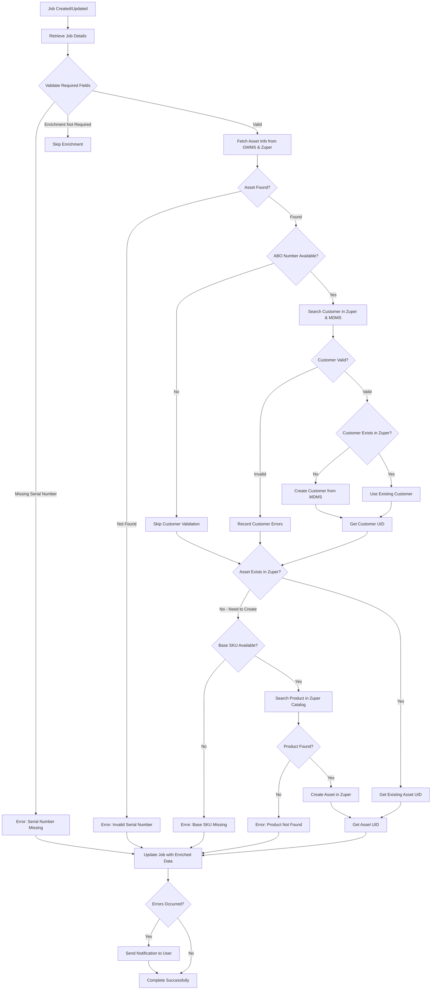

# Job Enrichment Automation - Complete Documentation

## 📋 Overview

**Workflow Name:** [Amway MSB] - Job Enrichment

**Purpose:** Automatically enriches job records by validating product serial numbers, fetching asset and warranty information from external systems (GWMS), managing customer and asset records in Zuper, and updating jobs with complete enriched data.

---

## 🔄 High-Level Process Flow



---

## 🔍 Detailed Process Flow

### **Phase 1: Initial Validation**

#### **Step 1: Job Retrieval**
- Webhook receives job creation/update event
- System fetches complete job details including custom fields

#### **Step 2: Required Field Validation**
**Fields Checked:**
- `Product Serial No` - The serial number of the product
- `Enrichment required?` - Flag to determine if enrichment should run (defaults to "Yes")
- `Zendesk ID` - Support ticket reference

**Validation Logic:**
```
IF Enrichment required = "Yes" AND Product Serial No is EMPTY
    → Error: "Product Serial Number Missing"
    → Send notification
    → Stop enrichment

ELSE IF Enrichment required = "Yes" AND Product Serial No EXISTS
    → Continue to Asset Lookup

ELSE IF Enrichment required ≠ "Yes"
    → Skip enrichment (no error)
```

---

### **Phase 2: Asset Information Retrieval**

#### **Step 3: Asset Lookup (Parallel)**
System searches for asset in TWO sources simultaneously:

**Source 1: GWMS (Global Warranty Management System)**
- Searches by Product Serial Number
- Returns: Warranty dates, Base SKU, Product SKU, ABO Number, Registration info

**Source 2: Zuper Database**
- Searches existing assets by serial number
- Returns: Existing asset details if already in system

#### **Step 4: Asset Information Consolidation**
**Priority Logic:**
- If asset exists in Zuper → Use Zuper data as primary source
- If asset NOT in Zuper but found in GWMS → Flag for asset creation

**Data Extracted:**
- Asset UID (if exists in Zuper)
- Product details (Base SKU, Product SKU, Product Name)
- Warranty information (Start date, End date, Status)
- Registration details (Date, Deadline)
- ABO Number (Amway Business Owner)
- Order information

**Validation:**
```
IF Asset NOT found in GWMS AND NOT found in Zuper
    → Error: "Invalid Product Serial Number. NOT FOUND"
    → Stop enrichment

IF Asset found
    → Extract ABO Number
    → Continue to Customer Lookup
```

---

### **Phase 3: Customer Validation & Management**

#### **Step 5: Customer Lookup (Conditional)**
**Trigger:** Only runs if ABO Number is available

Searches for customer in TWO sources simultaneously:

**Source 1: Zuper Database**
- Filter: ABO Number custom field = {ABO_NUMBER}
- Returns: Existing customer details if found

**Source 2: MDMS (Master Data Management System)**
- Searches by ABO Number
- Returns: Party ID, Address, Phone, Account Type, Personal ID

#### **Step 6: Customer Information Validation**
**Validation Checks:**

1. **Customer Existence Check**
   ```
   IF NOT found in Zuper AND NOT found in MDMS
       → Invalid Customer
       → Error: "Customer/ABO NOT FOUND in either Zuper/MDMS"
   ```

2. **Customer-Asset Mismatch Check**
   ```
   IF Asset has existing customer AND Asset's customer ≠ ABO Number customer
       → Error: "MISMATCH between customer associated to Asset and ABO Number"
   ```

3. **Customer-Job Mismatch Check**
   ```
   IF Job has existing customer AND Job's customer ≠ ABO Number customer
       → Error: "MISMATCH between customer associated to Job and ABO Number"
   ```

#### **Step 7: Customer Creation (If Needed)**
**Condition:** Customer found in MDMS but NOT in Zuper

**Process:**
1. Retrieve customer categories from Zuper
2. Map MDMS account type to Zuper category:
   - `BusinessOwner` → **ABO** category
   - `Member` → **APC** category
   - Other → **Product Owner** category
3. Create customer with:
   - Name, Mobile, Address (from MDMS)
   - Billing Address (from MDMS)
   - Custom Fields: Party ID, ABO Number, Personal ID

---

### **Phase 4: Asset Creation & Management**

#### **Step 8: Asset Creation Check**
**Condition:** Asset found in GWMS but NOT in Zuper

#### **Step 9: Base SKU Validation**
```
IF Base SKU is MISSING
    → Error: "BaseSKU Missing. FAILED to Create Asset"
    → Include any customer errors
    → Stop asset creation
```

#### **Step 10: Product Catalog Search**
- Search Zuper product catalog using Base SKU
- Match product by keyword search

**Validation:**
```
IF Product NOT found in catalog (total_records = 0)
    → Error: "Product Not Found for the BaseSKU. FAILED to create Asset"
    → Include any customer errors
    → Stop asset creation
```

#### **Step 11: Asset Creation**
**Process:**
1. Retrieve asset categories from Zuper
2. Match product category to asset category
3. Create asset with:
   - **Basic Info:** Code, Name, Serial Number
   - **Dates:** Purchase Date (Registration Date), Warranty Start, Warranty End
   - **Associations:** Customer UID, Product UID
   - **Custom Fields:**
     - Ordering ABO Number
     - Order Number
     - Warranty Type
     - Asset Migration Status
     - Country Code
   - **GWMS Info Group:**
     - Component Remark
     - Name, Mobile, Email
     - Date Of Sale
     - Registration Date
     - Registration Deadline

---

### **Phase 5: Job Update & Completion**

#### **Step 12: Job Enrichment**
**Data Updated in Job:**

1. **Product Information:**
   - Base SKU
   - Product SKU
   - Product Name
   - Product Serial Number
   - Original Order Number

2. **Warranty Status Calculation:**
   ```
   Function: checkIsInWarranty(WarrantyStart, WarrantyEnd)

   IF Current Date is between WarrantyStart and WarrantyEnd
       → "In-warranty"
   ELSE
       → "Out-warranty"
   ```

3. **Customer Information:**
   - ABO Number
   - Party ID
   - Customer UID (if not already associated)

4. **Asset Association:**
   - Add Asset UID to job's asset array (if not already present)

5. **Error Messages:**
   - Enrichment Error Message (consolidated errors if any)

#### **Step 13: Notification (If Errors)**
**Trigger:** Any validation or enrichment errors occurred

**Notification Details:**
- Title: "Job Notification"
- Message: Error description with Job ID
- Module: JOB
- Prompt: Yes (user must acknowledge)

---

## ⚠️ Validation Rules

### **1. Required Field Validations**
| Field | Rule | Action on Failure |
|-------|------|-------------------|
| Product Serial No | Required if Enrichment required = "Yes" | Stop enrichment, notify user |
| Base SKU | Required for asset creation | Skip asset creation, record error |
| ABO Number | Optional, but needed for customer lookup | Skip customer validation |

### **2. Data Integrity Validations**
| Validation | Check | Error Message |
|------------|-------|---------------|
| Serial Number Validity | Must exist in GWMS or Zuper | "Invalid Product Serial Number. NOT FOUND" |
| Customer Existence | Must exist in Zuper or MDMS | "Customer/ABO NOT FOUND in either Zuper/MDMS" |
| Asset-Customer Match | Asset's customer = ABO customer | "MISMATCH between customer associated to Asset and ABO Number" |
| Job-Customer Match | Job's customer = ABO customer | "MISMATCH between customer associated to Job and ABO Number" |
| Product Catalog | Base SKU must exist in product catalog | "Product Not Found for the BaseSKU. FAILED to create Asset" |

### **3. Business Logic Rules**

#### **Priority Rules**
- Zuper data takes precedence over GWMS data for existing assets
- Existing customer/asset records are reused (no duplicates)

#### **Conditional Processing**
- Customer validation skipped if ABO Number unavailable
- Asset creation skipped if asset already exists in Zuper
- Customer creation skipped if customer already exists in Zuper

#### **Error Accumulation**
- Multiple errors are consolidated into single error message
- All errors are included in notification
- Job is updated even if some steps fail

---

## 🎯 Success & Failure Scenarios

### **✅ Success Scenario 1: Complete Enrichment (New Customer & Asset)**
**Conditions:**
- Enrichment required = "Yes"
- Product Serial Number exists
- Asset found in GWMS but not in Zuper
- Customer found in MDMS but not in Zuper
- Base SKU exists
- Product found in catalog

**Flow:**
1. Validate fields ✓
2. Fetch asset from GWMS ✓
3. Fetch customer from MDMS ✓
4. Create customer in Zuper ✓
5. Create asset in Zuper ✓
6. Update job with all enriched data ✓
7. No errors, no notification

**Result:** Job fully enriched with new customer and asset records

---

### **✅ Success Scenario 2: Enrichment with Existing Records**
**Conditions:**
- Enrichment required = "Yes"
- Product Serial Number exists
- Asset already exists in Zuper
- Customer already exists in Zuper

**Flow:**
1. Validate fields ✓
2. Find existing asset in Zuper ✓
3. Find existing customer in Zuper ✓
4. Get Asset UID ✓
5. Get Customer UID ✓
6. Update job with references ✓
7. No errors, no notification

**Result:** Job enriched using existing records, no duplication

---

### **✅ Success Scenario 3: Skip Enrichment**
**Conditions:**
- Enrichment required ≠ "Yes"

**Flow:**
1. Check required fields
2. Detect enrichment not required
3. Exit gracefully

**Result:** No enrichment performed, no error, no notification

---

### **❌ Failure Scenario 1: Missing Serial Number**
**Conditions:**
- Enrichment required = "Yes"
- Product Serial Number is EMPTY

**Flow:**
1. Validate fields ✗
2. Error detected immediately

**Error Message:** "Product Serial Number Missing;"

**Notification:** "The Product Serial Number is missing for Job ID: {jobNo}"

**Result:** Job updated with error message, user notified

---

### **❌ Failure Scenario 2: Invalid Serial Number**
**Conditions:**
- Product Serial Number provided
- Serial number NOT found in GWMS
- Serial number NOT found in Zuper

**Flow:**
1. Validate fields ✓
2. Search GWMS ✗
3. Search Zuper ✗
4. Asset Info returns flag=false

**Error Message:** "Invalid Product Serial Number. NOT FOUND;"

**Notification:** "The product serial number is invalid or not found for Job ID: {jobNo}"

**Result:** Job updated with error message, user notified

---

### **❌ Failure Scenario 3: Base SKU Missing**
**Conditions:**
- Asset found in GWMS
- Base SKU field is empty in GWMS data

**Flow:**
1. Validate fields ✓
2. Fetch asset from GWMS ✓
3. Attempt to create asset
4. Check Base SKU ✗
5. Asset creation fails

**Error Message:** "BaseSKU Missing. FAILED to Create Asset;"
- Plus any customer validation errors

**Notification:** "The following errors occurred for Job ID: {jobNo}:\n{errorMessage}"

**Result:** Job updated with partial data and error messages, user notified

---

### **❌ Failure Scenario 4: Product Not in Catalog**
**Conditions:**
- Base SKU exists
- Product with Base SKU NOT found in Zuper product catalog

**Flow:**
1. Validate fields ✓
2. Fetch asset from GWMS ✓
3. Check Base SKU ✓
4. Search product catalog ✗
5. Asset creation fails

**Error Message:** "Product Not Found for the BaseSKU. FAILED to create Asset;"
- Plus any customer validation errors

**Notification:** "The following errors occurred for Job ID: {jobNo}:\n{errorMessage}"

**Result:** Job updated with partial data and error messages, user notified

---

### **⚠️ Failure Scenario 5: Customer Validation Errors**
**Conditions:**
- ABO Number available
- Customer NOT found in Zuper AND NOT found in MDMS
- OR Customer-Asset mismatch
- OR Customer-Job mismatch

**Flow:**
1. Validate fields ✓
2. Fetch asset ✓
3. Search customer ✗
4. Validation errors detected
5. Errors recorded but enrichment continues
6. Job updated with errors

**Error Messages (can be multiple):**
- "ABO NOT FOUND" (if customer info missing)
- "Customer/ABO NOT FOUND in either Zuper/MDMS"
- "MISMATCH between customer associated to Asset and ABO Number"
- "MISMATCH between customer associated to Job and ABO Number"

**Notification:** Consolidated error list for Job ID

**Result:** Job updated with partial enrichment and error messages, user notified

---

## 🔐 Edge Cases Handled

### **1. No ABO Number Available**
- **Scenario:** Asset data doesn't contain ABO Number
- **Handling:** Skip customer validation, continue with asset processing
- **Impact:** Job enriched without customer association

### **2. Multiple Error Conditions**
- **Scenario:** Multiple validation failures (e.g., Base SKU missing + Customer not found)
- **Handling:** All errors are accumulated and consolidated
- **Impact:** Single notification with all error messages

### **3. Enrichment Already Complete**
- **Scenario:** Job already has enriched data from previous run
- **Handling:** Existing records are found and reused
- **Impact:** No duplicate customer or asset creation

### **4. Partial GWMS Data**
- **Scenario:** GWMS returns asset but missing some fields
- **Handling:** Use available data, flag missing fields as errors
- **Impact:** Partial enrichment with error messages

### **5. Category Mapping Failures**
- **Scenario:** MDMS account type doesn't match predefined categories
- **Handling:** Default to "Product Owner" category
- **Impact:** Customer created with generic category

### **6. Warranty Date Calculation**
- **Scenario:** Missing warranty start or end dates
- **Handling:** Warranty status calculation handles null dates gracefully
- **Impact:** Warranty status may be undefined or "Out-warranty"

### **7. Existing Asset with Different Customer**
- **Scenario:** Asset exists but associated with different customer than ABO Number
- **Handling:** Error flagged, mismatch recorded
- **Impact:** Job updated with error message, manual intervention needed

### **8. Job Already Has Customer**
- **Scenario:** Job already associated with a customer different from ABO customer
- **Handling:** Mismatch detected and flagged as error
- **Impact:** Job updated with error message, customer not overwritten

---

## 📊 Data Flow Summary

### **Input Sources**
1. **Webhook Event** → Job UID
2. **Zuper API** → Job details, existing customer/asset records, product catalog, categories
3. **GWMS API** → Asset warranty and product information
4. **MDMS API** → Customer master data

### **Output Destinations**
1. **Zuper Database** → Updated job record
2. **Zuper Database** → New customer records (if needed)
3. **Zuper Database** → New asset records (if needed)
4. **User Notifications** → Error alerts

### **Data Transformations**
1. **Date Formatting** → Convert warranty dates to "yyyy-MM-DD HH:mm:ss" format
2. **Category Mapping** → MDMS account types to Zuper categories
3. **Warranty Calculation** → Date range validation for in/out warranty status
4. **Error Consolidation** → Multiple error messages into single notification

---

## 🎮 System Integrations

### **External Systems**
| System | Purpose | API Type | Error Handling |
|--------|---------|----------|----------------|
| GWMS | Asset and warranty lookup | GET with serial number | Continue with error output |
| MDMS | Customer master data lookup | GET with ABO number | Continue with error output |
| Zuper | CRUD operations for jobs, customers, assets | GET/POST/PUT | Retry on fail |

### **API Endpoints Used**
- `GET /jobs/{uid}` - Fetch job details
- `GET /assets?filter.serial_no={serial}` - Search assets
- `POST /v2/customers/filter` - Search customers
- `GET /customers/category` - Get customer categories
- `POST /customers_new` - Create customer
- `POST /product/filter` - Search products
- `GET /assets/category` - Get asset categories
- `POST /assets` - Create asset
- `GET /settings/custom_fields` - Get custom field schema
- `PUT /jobs` - Update job
- `POST /user_notification` - Send notification

---

## 📝 Custom Fields Reference

### **Job Custom Fields**
- `Product Serial No` - Input field for serial number
- `Enrichment required?` - Flag to enable/disable enrichment
- `Zendesk ID` - Support ticket reference
- `Base SKU` - Product base identifier (populated by workflow)
- `Product SKU` - Full product identifier (populated by workflow)
- `Product` - Product name (populated by workflow)
- `Original Order Number` - Order reference (populated by workflow)
- `Item Warranty Status` - In-warranty/Out-warranty (calculated by workflow)
- `ABO Number` - Business owner number (populated by workflow)
- `Party ID` - Customer party identifier (populated by workflow)
- `Enrichment Error Message` - Consolidated error messages (populated on failures)

### **Customer Custom Fields**
- `Party ID` - MDMS party identifier
- `ABO Number` - Amway Business Owner number
- `Personal ID` - Personal identifier from MDMS

### **Asset Custom Fields**
- `Ordering ABO Number` - ABO who ordered the asset
- `Order Number` - Original order reference
- `Warranty Type` - Type of warranty
- `Asset Migration Status` - Migration tracking
- `Country Code` - Country of registration

### **Asset Custom Field Group: GWMS Info**
- `Component Remark` - Additional component notes
- `Name` - Registered owner name
- `Mobile` - Contact mobile number
- `Email` - Contact email
- `Date Of Sale` - Sale date from GWMS
- `Registration Date` - Asset registration date
- `Registration Deadline` - Last date for registration

---

## 🚦 Workflow Execution States

### **Complete Success**
- All validations passed ✓
- Asset found or created ✓
- Customer found or created ✓
- Job fully enriched ✓
- No errors
- No notification sent

### **Partial Success with Warnings**
- Main enrichment completed ✓
- Minor validation warnings
- Customer mismatches detected
- Job updated with errors
- Notification sent

### **Validation Failure**
- Required field missing ✗
- Invalid serial number ✗
- Enrichment stopped early
- Job updated with error message
- Notification sent

### **System Failure**
- API errors
- Network issues
- Workflow continues with error output
- Best-effort enrichment
- Notification sent if errors recorded

---

## 📞 Notification System

### **When Notifications are Sent**
- Product Serial Number missing
- Invalid/not found serial number
- Base SKU missing (asset creation fails)
- Product not found in catalog
- Customer validation errors
- Any enrichment errors

### **Notification Format**
```json
{
  "title": "Job Notification",
  "message": "Error description for Job ID: {jobNo}",
  "module": "JOB",
  "prompt": true,
  "module_uid": "{job_uid}",
  "job_no": "{job_number}"
}
```

### **When Notifications are NOT Sent**
- Enrichment not required (graceful skip)
- Successful enrichment with no errors
- Existing records found and used successfully

---

## 🔄 Configuration

### **API Configuration**
```javascript
{
  baseUrl: "https://stagingv2.zuperpro.com/api",
  apiKey: "8744dca35044a579f4152e752be46f42",
  companyId: "1589",
  serviceApiUrl: "https://staging.zuperpro.com/service/integrations/app/amway_poc/run",
  asset: {
    customFieldsGroups: {
      GWMSInfo: {
        uid: "db1e0234-f638-491d-8661-cd01b2497800",
        name: "GWMS Info"
      }
    }
  }
}
```

### **Retry Configuration**
- Job API calls: Retry enabled
- Customer API calls: Retry enabled
- Asset API calls: Retry enabled
- External APIs (GWMS/MDMS): Continue on error

---

## 📈 Performance Characteristics

### **Parallel Processing**
- GWMS and Zuper asset search run simultaneously
- MDMS and Zuper customer search run simultaneously
- Reduces total execution time

### **Conditional Execution**
- Steps skipped when not needed (e.g., no ABO → skip customer)
- Early exit for "Enrichment not required"
- Efficient resource usage

### **Error Recovery**
- Graceful degradation on partial failures
- Best-effort enrichment continues
- All errors collected and reported

---

## 🎓 Key Takeaways

### **What This Workflow Does**
1. ✅ Validates job data has required fields
2. ✅ Fetches asset information from warranty system (GWMS)
3. ✅ Searches for existing records to avoid duplicates
4. ✅ Creates customer records from master data (MDMS) when needed
5. ✅ Creates asset records with full warranty details when needed
6. ✅ Calculates warranty status (in-warranty vs out-warranty)
7. ✅ Updates job with all enriched data
8. ✅ Validates data integrity (customer-asset-job associations)
9. ✅ Sends notifications when errors occur
10. ✅ Handles multiple error scenarios gracefully

### **What This Workflow Prevents**
1. 🚫 Duplicate customer records
2. 🚫 Duplicate asset records
3. 🚫 Orphaned data (unlinked customers/assets)
4. 🚫 Invalid product associations
5. 🚫 Silent failures (all errors reported)
6. 🚫 Data inconsistencies across systems

### **What Requires Manual Intervention**
1. 🔧 Customer-asset mismatches (different customers in different systems)
2. 🔧 Customer-job mismatches (job assigned to wrong customer)
3. 🔧 Product not found in catalog (needs product master data update)
4. 🔧 Invalid serial numbers (data quality issue)
5. 🔧 Customer not found in MDMS or Zuper (may need customer creation)

---

**Document Version:** 1.0
**Last Updated:** 2025-10-14
**Workflow Version:** Production
